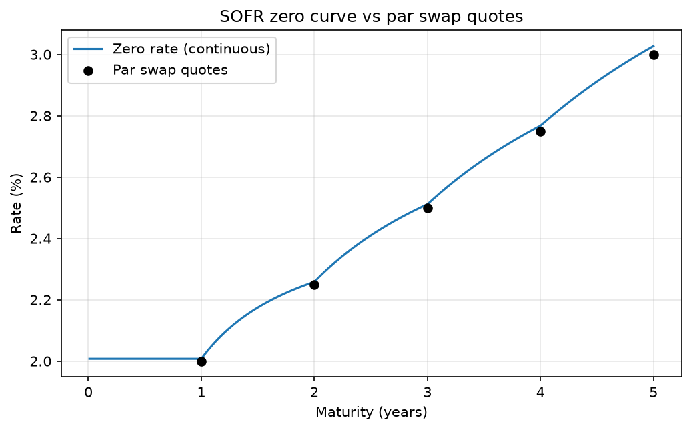

# SOFR Cap Pricer

I built a pricer for a 5-year SOFR cap in Python, from the swap curve to the risk
measures. Everything is coded from scratch with NumPy and SciPy, and checked with
57 unit tests.



## Results

The cap has a USD 10M notional, a 3% strike and pays quarterly (20 caplets).
Volatility is 20% (lognormal).

| | Value |
|---|---|
| Cap price | 223,252 USD |
| Floor price | 239,168 USD |
| Payer swap at 3% | -15,916 USD |
| DV01 | +2,066 USD per bp |
| Vega | +6,678 USD per vol point |
| Gamma (parallel shifts) | about 11.5 USD per bp² |

Bucket deltas (USD per bp, one swap rate moved at a time):

| 1y | 2y | 3y | 4y | 5y |
|---|---|---|---|---|
| -248 | -605 | -501 | -362 | +3,781 |

Almost all the risk is on the 5y swap rate. The notebook explains why the shorter
buckets are negative.

## How it works

1. **Curve.** I bootstrap discount factors from five annual SOFR swap rates
   (2%, 2.25%, 2.5%, 2.75%, 3%). Each swap rate gives one new discount factor, so the
   bootstrap has a closed form. Between maturities I interpolate ln(DF) linearly,
   which gives constant forwards inside each year.
2. **Forwards.** From the curve I compute 20 quarterly forward rates.
3. **Pricing.** Each caplet is priced with Black-76 and discounted to its payment date.
   Compounded SOFR is only known at the end of the period, so I use the effective time
   of Lyashenko and Mercurio: v = t_start + (t_end - t_start) / 3.
4. **Risk.** I shift the swap rates (or the volatility), rebuild the whole curve and
   reprice, using central differences. This gives the DV01, the bucket deltas and the
   vega. I also compare the linear estimate with a full repricing for larger shifts to
   measure convexity.

## Conventions

| | Convention |
|---|---|
| Payment accrual | Act/360 (one year = 365/360, one quarter = 91.25/360) |
| Model time | Act/365F |
| Interpolation | linear in ln(DF) |
| Curves | single curve for projection and discounting (SOFR is also the collateral rate) |
| Volatility | one flat lognormal vol for all caplets |

## Validation

The tests compare the code with independent reference values and check identities
that must hold whatever the parameters:

- curve values (discount factors, zero rates, forwards) against hand-computed values;
- the curve gives back the five input swap rates;
- caplet minus floorlet = F - K, and cap minus floor = payer swap, for several vols and strikes;
- at the at-the-money strike, the swap is worth zero and cap = floor;
- with zero volatility, the cap is worth its discounted intrinsic value;
- the bucket deltas add up to the DV01.

The parity test is the one that caught my main bug: my first cap price was 249k USD,
because the caplets were not discounted.

## Project structure

```
├── curve.py          # bootstrap, Curve class (DF, zero rates), forwards, par swap rate
├── black.py          # Black-76 caplet and floorlet formulas
├── cap.py            # cap/floor pricing, payer swap, pricing from market quotes
├── risk.py           # DV01, bucket deltas, vega, steepener scenario
├── tests/            # unit tests (pytest)
├── notebook.ipynb    # results and charts
└── requirements.txt
```

## How to run

```
python -m venv .venv
.venv\Scripts\activate          # on macOS/Linux: source .venv/bin/activate
pip install -r requirements.txt
pytest -v
```

Then open `notebook.ipynb` with the `.venv` kernel.

## References

- A. Lesniewski, *Interest Rates and FX Models*, Lectures 1 (rates and curves) and 5
  (caps, floors and swaptions), Baruch College.
- A. Lyashenko and F. Mercurio, *Looking Forward to Backward-Looking Rates* (2019).
- CFA Institute, CFA Program Curriculum, Level I (2027): Fixed Income (spot rates, forward rates, yield curve) and Derivatives (pricing of swaps and options).
